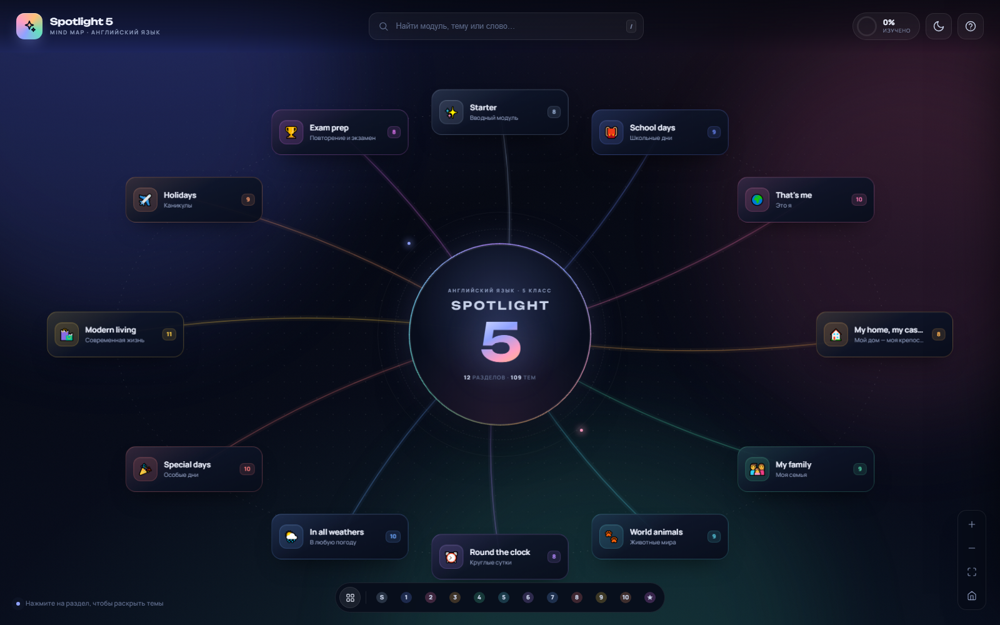
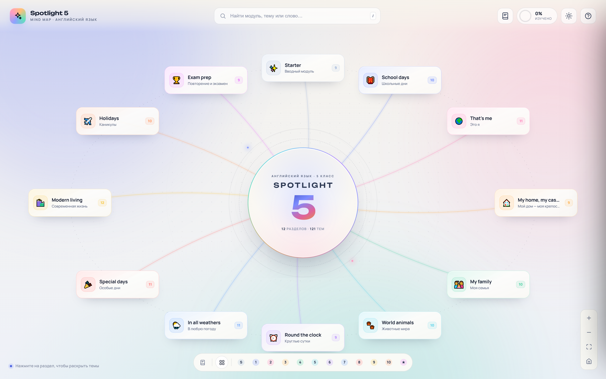
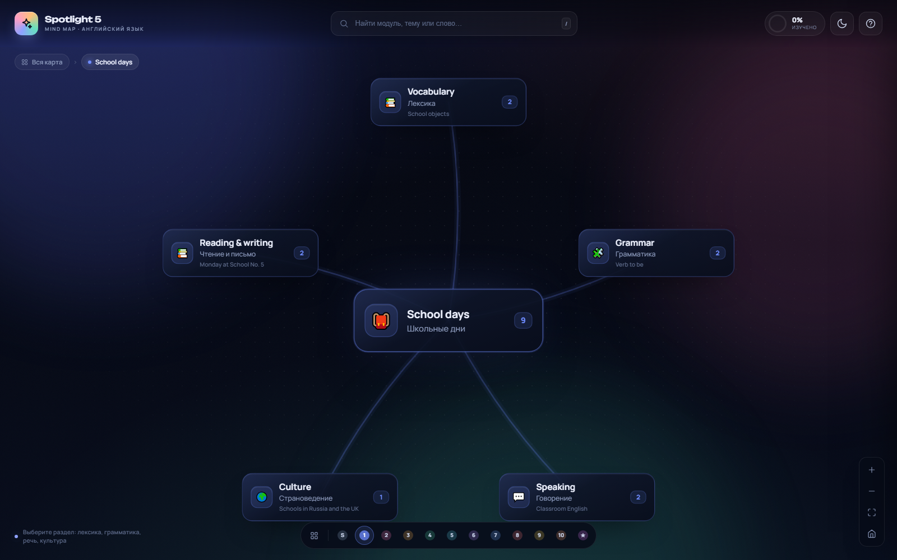
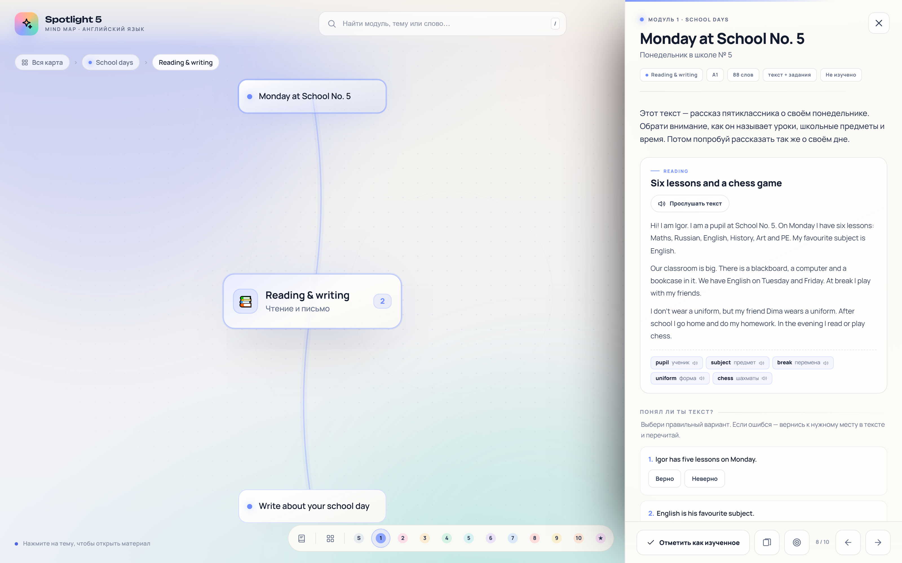
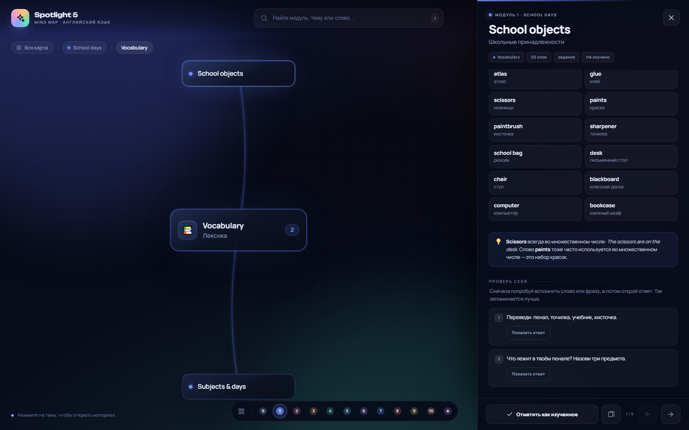
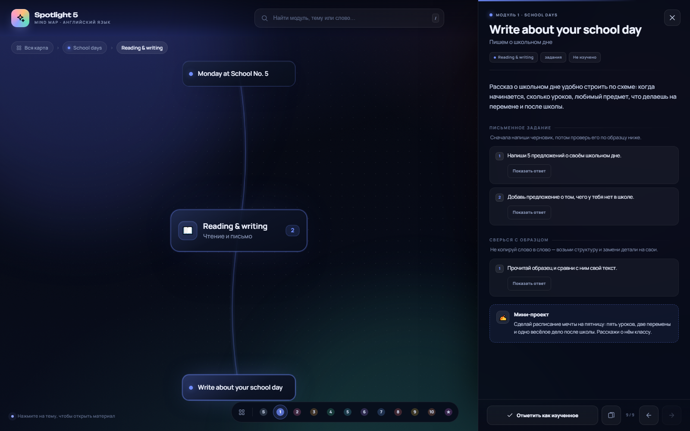
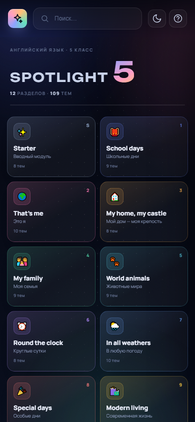
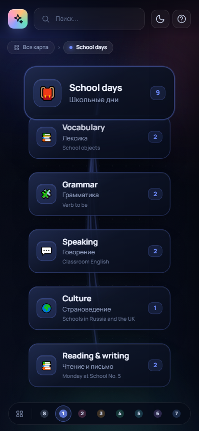

# Spotlight 5 — интерактивная карта английского языка

**Живая версия:** [nikitamitrasov-netizen.github.io/spotlight-5](https://nikitamitrasov-netizen.github.io/spotlight-5/)  
**Репозиторий:** [github.com/nikitamitrasov-netizen/spotlight-5](https://github.com/nikitamitrasov-netizen/spotlight-5)

Большая mind map по всем разделам УМК «Английский в фокусе. Spotlight 5» (5 класс).
Карта раскрывается постепенно: **раздел → блок → тема**, а в правой панели открывается
материал темы — слова с переводом и озвучкой, правила, примеры, тексты и задания.

Материал написан не как справочник, а как объяснение учителя: у каждой темы есть
короткое «зачем это нужно», типичная ошибка (если она есть) и практика с ответами.
К каждому модулю добавлен отдельный блок **Reading & writing** — текст для чтения
с проверкой понимания и письменное задание с образцом.

## Превью

















## Как открыть

Просто откройте `index.html` двойным щелчком в браузере. Сервер и установка зависимостей
не нужны: страница работает локально, в том числе без интернета (шрифты в этом случае
заменяются системными).

Лучше всего открывать в современном Chrome, Edge или Safari. Звук слов работает через
встроенный синтез речи браузера.

## Что внутри

- **12 разделов**: Starter, модули 1–10 и итоговое повторение.
- **70 блоков** и **121 тема**.
- Около **870 слов и выражений** с переводом.
- **12 текстов для чтения** — по одному на каждый раздел, с глоссарием, вопросами
  «верно/неверно», открытыми вопросами и мини-проектом. Уровни A1–A2, 70–91 слово.
- **12 письменных мастерских**: задание, образец текста и речевая практика.
- **12 гидов по модулям**: карта модуля, главная грамматика, мини-диалог, план на неделю
  и задания для самопроверки.
- **291 задание** с кнопкой «Показать ответ»: перевод, вставка пропущенного,
  вопросы по тексту, работа с ошибками.
- Грамматика 5 класса: `to be`, местоимения, артикли, множественное число, `have got`,
  `there is/are`, `can`, Present Simple, Present Continuous, Past Simple, `some/any`,
  `much/many`, предлоги, вопросительные конструкции и повторение времён.
- Страноведение: школы и дома России и Британии, сувениры, животные, праздники,
  покупки, каникулы.
- Подготовка к проверочным: карта времён, местоимения и предлоги, 40 неправильных
  глаголов, советы по выполнению теста.

## Управление

| Действие | Что делает |
|---|---|
| Клик по разделу | Раскрывает блоки раздела |
| Клик по блоку | Раскрывает темы блока |
| Клик по теме | Открывает панель с материалом |
| Колесо мыши / щипок | Масштаб |
| Перетаскивание | Перемещение по карте |
| `+` / `−` | Приблизить / отдалить |
| Кнопка «домой» | Вернуться к обзору |
| Поиск (`/` или `Ctrl+K`) | Поиск по разделам, темам, словам и фразам |
| `Esc` | Закрыть панель / подняться на уровень выше |
| Кнопка «Карточки» в панели | Тренажёр слов выбранного модуля |
| Кнопка-мишень в панели | Тест по модулю: 10 вопросов, результат сохраняется |
| Книга внизу слева / «Тексты» | Библиотека всех 12 текстов с уровнем и числом слов |
| Кольцо прогресса / «Прогресс» | Результаты, тесты, ошибки, CSV, печать и настройки |
| «Отметить как изученное» | Сохраняет прогресс в браузере |

Прогресс хранится в `localStorage` и виден на кольце в шапке и на карточках разделов.
Кнопка с солнцем/луной переключает светлую и тёмную тему. В панели «Прогресс» можно
включить крупный текст, высокий контраст, посмотреть ошибки, выгрузить CSV и распечатать
отчёт. Слова, в которых были ошибки, возвращаются первыми в карточках.

Сайт можно установить как приложение (PWA): он кэширует страницы и работает офлайн.
Для установки нужен `http://localhost` или HTTPS: по локальному IP без HTTPS браузер
может не включить service worker. Через `file://` сайт работает, но PWA и офлайн-кэш — нет.

## Как устроена панель темы

1. **Зачем это нужно** — короткое объяснение человеческим языком.
2. **Основной материал** — слова, правила, таблицы, примеры с озвучкой.
3. **Так не говорят** — типичная ошибка и правильный вариант.
4. **Проверь себя** — задания с ответами, которые открываются по кнопке.

В темах чтения дополнительно есть текст с глоссарием, тест «верно/неверно»,
открытые вопросы и мини-проект.

## Файлы

```
index.html            — разметка и подключение стилей/скриптов
css/styles.css        — оформление, анимации, адаптивность
css/features.css      — библиотека текстов, тесты, прогресс, онбординг
js/data-1.js          — Starter и модули 1–3
js/data-2.js          — модули 4–7
js/data-3.js          — модули 8–10 и итоговое повторение
js/data-reading.js    — 12 текстов для чтения и 12 письменных мастерских
js/data-theory.js     — 12 гидов по модулям
js/extras-1.js        — пояснения и задания: Starter, модули 1–3
js/extras-2.js        — пояснения и задания: модули 4–7
js/extras-3.js        — пояснения и задания: модули 8–10, повторение
js/app.js             — карта, переходы, панель, поиск, прогресс, карточки
js/features.js        — тексты, тесты, дашборд, CSV, PWA, говорение
manifest.webmanifest  — манифест устанавливаемого приложения
sw.js                 — офлайн-кэш
assets/               — иконки приложения
preview/              — скриншоты
paper/                — научная работа (DOCX, PDF, скрипт сборки)
presentation/         — презентация (PPTX, PDF, скрипт сборки)
```

## Тесты и результаты

- Тест по модулю собирается из 3–4 вопросов по тексту и 6–7 вопросов по лексике.
- Результат сохраняется в браузере; в дашборде видны последние тесты и средний балл.
- Неверные слова попадают в «ошибки» и возвращаются первыми в карточках.
- CSV выгружается с разделителем `;` и BOM — открывается в Excel без настройки.
- Печать отчёта идёт через системное окно печати; лишние элементы интерфейса скрыты.

## Презентация

В папке `presentation/` лежит презентация к работе — 13 слайдов:

- `presentation/Spotlight5_prezentatsiya.pptx` — редактируемая презентация;
- `presentation/Spotlight5_prezentatsiya.pdf` — версия для показа и печати;
- `presentation/make_pptx.py` — скрипт сборки.

В презентации есть титульный слайд, проблема, цель и задачи, схема интеллект-карты,
объяснение психологических оснований, цифры ресурса, скриншоты интерфейса,
схема эксперимента, таблица результатов, диаграмма прироста и выводы.
К каждому слайду добавлены заметки для выступления.

## Научная работа

В папке `paper/` лежит оформленная научно-исследовательская работа по теме
«Интерактивная интеллект-карта как средство систематизации иноязычного материала
при обучении английскому языку в 5 классе»:

- `paper/Spotlight5_nauchnaya_rabota.docx` — редактируемый документ;
- `paper/Spotlight5_nauchnaya_rabota.pdf` — версия для печати и отправки;
- `paper/make_paper.py` — скрипт сборки документа.

Работа занимает 12 страниц: титульный лист, аннотация, содержание, введение,
две главы (теоретическая и практическая), заключение, список из 15 источников,
таблица результатов и рисунок с интерфейсом карты. Перед сдачей заполните
поля титульного листа и замените демонстрационные показатели эксперимента
на фактические данные вашей апробации.

## Публикация

Сайт опубликован через **GitHub Pages**:

- URL: https://nikitamitrasov-netizen.github.io/spotlight-5/
- Репозиторий: https://github.com/nikitamitrasov-netizen/spotlight-5
- Источник Pages: ветка `main`, папка `/`, файл `.nojekyll` уже добавлен.

Любой push в `main` автоматически пересобирает сайт за 30–60 секунд. Прогресс на
опубликованной версии хранится отдельно от локальной.

## Примечание

Содержание составлено по модулям и темам УМК Spotlight 5 и адаптировано для
самостоятельного повторения. Это не официальное издание издательства «Просвещение»;
формулировки правил и подбор лексики — авторские. Перед контрольной сверяйтесь с
учебником и рабочей тетрадью.
